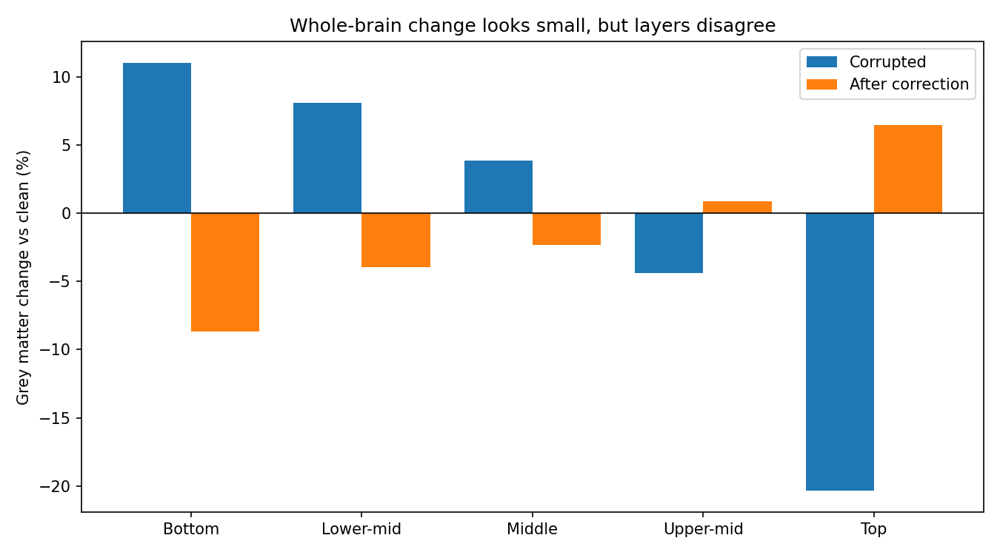
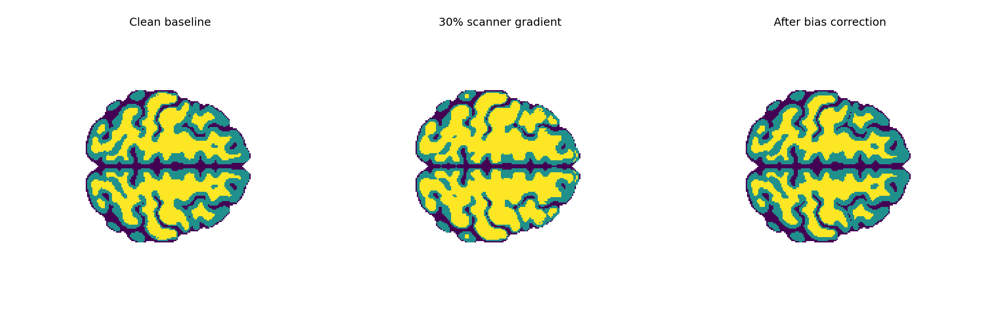

# mri-bias-field-segmentation
Testing how a scanner brightness gradient messes up MRI brain segmentation... and seeing how well a simple linear correction fixes it.

# The idea
A brain MRI is a 3D grid of brightness values. On a T1 scan, fluid (CSF) is dark, grey matter is medium, and white matter is bright. Real scanners don't light the brain evenly, so a program that labels tissue by brightness can get fooled. This project shows that happening on the MNI152 average brain, then tries to fix it.

# What the notebook does
1. **Baseline:** labels every brain voxel as CSF, grey matter, or white matter using k-means on brightness only, and grades it against the MNI152 tissue probability maps (Dice score).
2. **Break it:** multiplies the brightness by a smooth 30% bottom-to-top gradient (a simulated scanner bias field) and re-labels.
3. **Fix it:** estimates the gradient with an iterative least-squares fit (a simplified take on the idea behind N4) and divides it out.

# Key finding
Whole-brain grey matter volume changed only +0.9% under the gradient, but by height layer it changed +11.0% in the bottom fifth and -20.3% in the top fifth. The errors cancel in the total, so a single overall number hides the problem.

*Grey matter change vs. the clean scan, by height layer (bottom to top).*

*Slice 130 (near the top): clean, corrupted, and corrected labels. Purple = CSF, teal = grey matter, yellow = white matter.*

# Results
| | Grey matter Dice | White matter Dice | CSF Dice |
|---|---|---|---|
| Clean | 0.889 | 0.932 | 0.657 |
| 30% gradient | 0.859 | 0.887 | 0.657 |
| After correction | 0.877 | 0.917 | 0.656 |

# Limitations
- The correction is a simple linear fit, not full N4. It recovered most of the Dice score but overcorrected the top and bottom layers (top +6.4%, bottom -8.7% vs. clean). I'm not sure why yet.
- The MNI152 template is an average of 152 people, not a real patient.
- The "answer key" is the most likely tissue from probability maps, not a manual labeling.
- Educational project, not for medical use.

# Run it
Open `mri_bias_field_segmentation.ipynb` in Google Colab (or Jupyter) and run all cells. It needs internet on the first run to download the MNI152 data.

# Built by Christopher Dass
